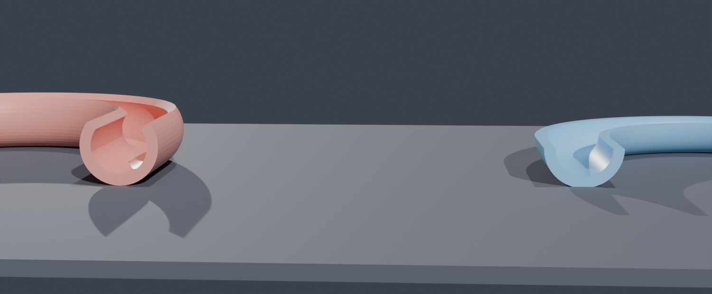
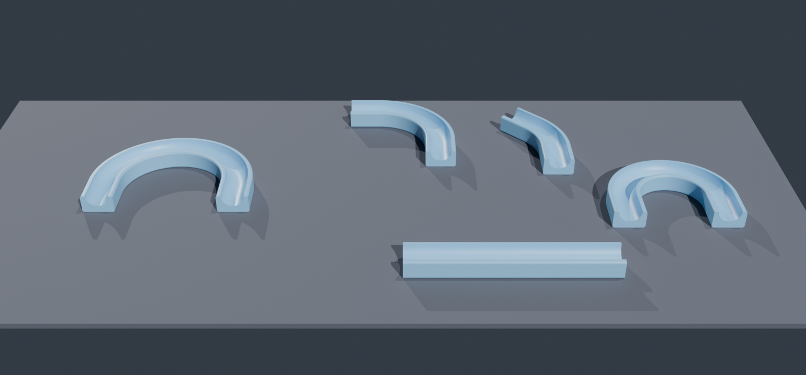

# 3D 打印件 —— 防折护套 / 转角件（可打印版）

硅胶管一折就瘪、瘪了以后泵有压力也撑不开，所以要用硬壳撑住。

**配套管子：D9 × D10 × 1m，壁厚 0.5mm**（外径 10 / 内径 9）。下面所有尺寸都是按这个算的。
下面这套是**经过几次改版后终于能打出来的版本**。

---

## 一、截面（全部设计的核心，按外径 Ø10 的管子）

```
   ┌──────────────────────────┐   ← 顶面是平的，槽口在这一层敞开
   │  ╭────────────────────╮  │
   │ ╱                        ╲ │   ← 半圆槽 Ø10.6，从顶面往下挖 5.3
   │ ╰───────────────────────╯ │
   │                          │   ← 侧壁 1.7mm / 槽底实心 2.7mm
   ╰──────────────────────────╯   ← ★ 14mm 全宽平底，直接贴热床
        ↑ 四角 R0.8 小圆角（只防翘边，不做大圆角）
```

| 尺寸 | 值 |
|---|---|
| 全宽 | **14.0 mm** |
| 全高 | **8.0 mm** |
| 半圆槽 | **Ø10.6（R5.3）**，从顶面往下挖（管子 Ø10 + 0.6 间隙） |
| 四角圆角 | R0.8 |
| 侧壁厚 | 1.7 mm（单边） |
| 槽底实心 | 2.7 mm |

**一根管子用两片**：管子放进下半片，另一片**同一个件翻面**扣上去，
两端用扎带 / 电工胶带 / 热缩管箍 2~3 道。

---

## 二、为什么是这个形状（改版教训）

| 版本 | 长什么样 | 为什么打不出来 |
|---|---|---|
| v1 `sleeve_*.stl` | Ø12 × 150mm 螺旋管，**竖着打** | 接触面积只有 55mm²，高宽比 12.5:1，整件是**连续螺旋带 = 弹性件**，喷嘴一碰就倒 → 炒面 |
| v2 `bend_*.stl` | 圆管**躺平** | 圆管躺下的底面是下凸曲面，实测**每升高 1mm 宽度增加 3.4mm = 73° 悬垂**（FDM 极限 45°），整条底面全在半空 → 炒面 |
| v3 半壳第一版 | 半圆外壳 + 3.1mm 窄平底 | 平底是圆弧相切出来的窄条，**实机粘不住热床**，打一半飞了 |
| **v4（现在）** | **14mm 全宽方底 + 顶面半圆槽** | ✅ 底面是完整矩形平面，四角小圆角；外壁垂直、槽往上张开 → **零悬垂** |


（左：v2 圆管躺放，底面 73° 悬空；右：现在的方底版本）

---

## 三、文件

### 转角件

| 文件 | 转角 | 中心半径 | 外形 (mm) | 用途 |
|---|---|---|---|---|
| `halfbend_180_R25.stl` | 180° | 25 mm | 64 × 44 × 8.0 | ★ 蛇形回折（主力件），管距 50mm |
| `halfbend_90_R25.stl`  | 90°  | 25 mm | 44 × 44 × 8.0 | 直角拐弯 |
| `halfbend_45_R25.stl`  | 45°  | 25 mm | 28 × 43 × 8.0 | 小角度转向（**先打这个试**） |
| `halfbend_180_R18.stl` | 180° | 18 mm | 50 × 37 × 8.0 | 更紧凑，管距 36mm |

### 直段

| 文件 | 长度 |
|---|---|
| `sleeve_half_150.stl` | 150 mm |
| `sleeve_half_075.stl` | 75 mm |
| `sleeve_half_050.stl` | 50 mm |

直段和转角件**截面完全一样**，可以直接对接。



---

## 四、打印参数

| 项 | 建议 |
|---|---|
| 摆放 | **直接平放**（STL 自带姿态就是对的），不要旋转、不要开支撑 |
| 支撑 | **不需要**（整件零悬垂） |
| 材料 | **PETG**。PLA 太脆，反复弯会裂 |
| 层高 | 0.2 mm |
| 壁厚 | 2 圈（0.8mm） |
| 填充 | 15% 或 0 |
| 底边 | 14mm 宽平底，**不需要 brim** |
| 首层 | 喷嘴贴近一点、首层放慢，平底咬床更牢 |

---

## 五、组装

```
  蛇形面板（俯视）：

   ┌── halfbend_180 ──┐                ┌── halfbend_180 ──┐
   │                  │                │                  │
   └──────────────────┴────────────────┴──────────────────┘
       ↑ 中间用 sleeve_half_* 直段接，长度随意

  每一段：管子放进下半片 -> 扣上上半片（同一个件翻面）-> 两端箍住
```

固定到身上：缝进网布背心 / 宽弹力带绑 / 贴在开槽 EVA 垫上。

---

## 六、生成与自检

```powershell
# 直段
& 'E:\Blender\blender.exe' -b --factory-startup --python .\projects\body-cooler\cad\make_sleeve_half.py

# 转角件
& 'E:\Blender\blender.exe' -b --factory-startup --python .\projects\body-cooler\cad\make_half_bends.py

# 渲染预览
& 'E:\Blender\blender.exe' -b --factory-startup --python .\projects\body-cooler\cad\render_halfbends.py

# 旧版打印性诊断（逐层宽度实测）
& 'E:\Blender\blender.exe' -b --factory-startup --python .\projects\body-cooler\cad\check_bend_print.py
```

改截面：`make_sleeve_half.py` 顶部改 `TUBE_OD`（管子外径）即可，其余 `R_G / W / H` 全部由它推导。
改转角角度/半径：`make_half_bends.py` 的 `VARIANTS` 表。

**当前自检：7 个件全部 `non_manifold=0  open=0`，水密实体可直接切片。**

---

## 七、历史文件（**不能直接打印，仅留档**）

| 文件 | 为什么留着 |
|---|---|
| `sleeve_A_flex / A_short / B_mid / C_rigid.stl` | v1 螺旋护套。竖打炒面；要用必须加 brim、降速 60%、裁成 50~60mm 分段 |
| `bend_45 / 90 / 180_R25, bend_180_R18.stl` | v2 开口导槽转角件。圆管躺放，底面 73° 悬垂，必须加支撑才能打 |
| `preview_bends.png`、`preview_iso.png`、`preview_axial.png` | 旧版渲染图，仅作对比 |

> ⚠ 上面这些**不要再拿去打印**，浪费时间。

